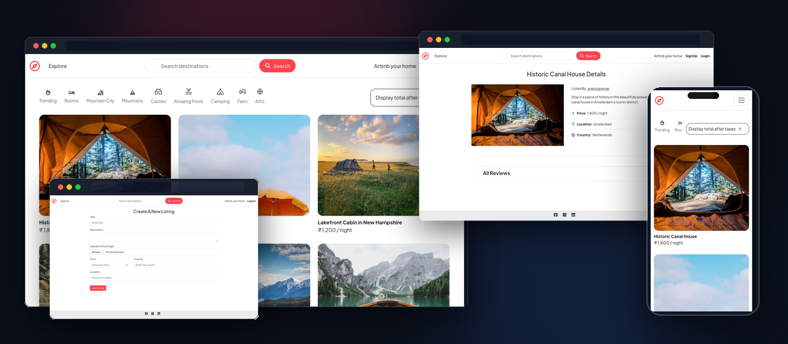
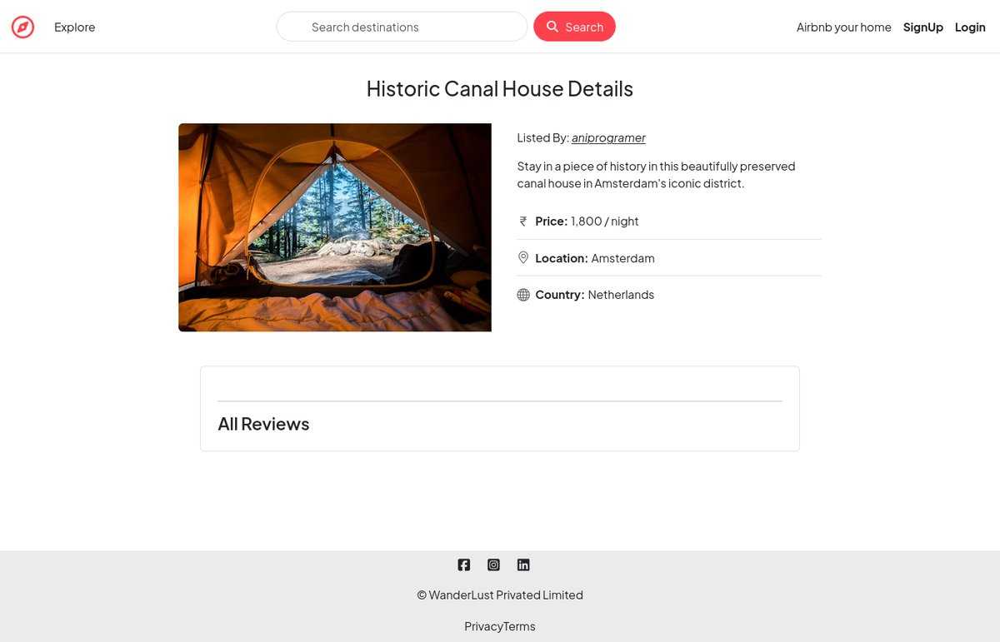
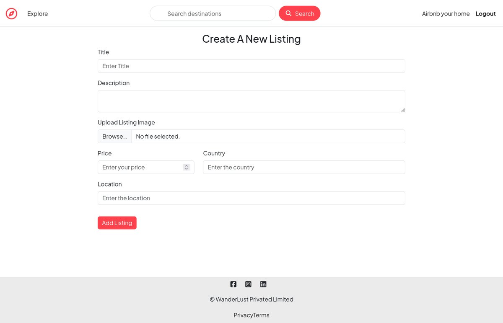
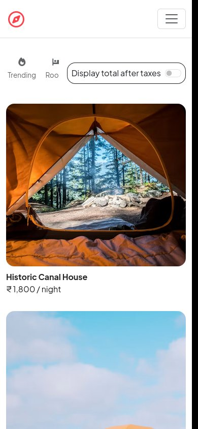

<div align="center">



<br />
<br />

# 🌍 Wanderlust

**A full-stack accommodation marketplace inspired by Airbnb, enabling users to discover, list, and review unique places around the world.**

<br />

[](https://ani-wanderlust.onrender.com)
[](https://github.com/aniprogramer/wanderlust)
[](https://github.com/aniprogramer/wanderlust/issues)
[](https://github.com/aniprogramer/wanderlust/issues)

<br />

[](https://nodejs.org/)
[](https://expressjs.com/)
[](https://www.mongodb.com/atlas)
[](https://cloudinary.com/)
[](https://www.passportjs.org/)
[](https://getbootstrap.com/)
[](https://render.com/)

<br />

<p align="center">
  <b>✅ Secure Authentication &amp; Authorization</b> &nbsp;•&nbsp;
  <b>✅ Property Listing Management</b> &nbsp;•&nbsp;
  <b>✅ Image Uploads with Cloudinary</b><br />
  <b>✅ Reviews &amp; Ratings System</b> &nbsp;•&nbsp;
  <b>✅ Responsive Design</b> &nbsp;•&nbsp;
  <b>✅ MVC Architecture</b> &nbsp;•&nbsp;
  <b>✅ Session-Based Authentication</b>
</p>

</div>

---

## 🚀 Live Demo

Visit the live application:

👉 **[https://ani-wanderlust.onrender.com](https://ani-wanderlust.onrender.com)**

Explore listings, create properties, upload images, and submit reviews in real time.

---

## 📌 Project Overview

**Wanderlust** is a full-stack web application engineered on the **Model-View-Controller (MVC)** architectural pattern. It delivers an end-to-end marketplace experience where hosts can publish accommodations and travelers can discover destinations with transparent community reviews and ratings.

### 💡 Problem Solved

Traditional starter web apps frequently omit essential production requirements: granular authorization, resilient session storage, centralized validation, and production cloud media pipelines. Wanderlust bridges this gap by demonstrating:

- **Strict role-based authorization** restricting edit/delete capabilities to verified record owners.
- **Cloud-hosted media offloading** (Cloudinary) preventing server filesystem bloat.
- **Persistent session storage** in MongoDB Atlas decoupled from server memory.
- **Standardized RESTful design** paired with atomic server-side (Joi) and client-side data validation.

---

## ✨ Features

| Feature                          | Description                                                                                                                                         |
| :------------------------------- | :-------------------------------------------------------------------------------------------------------------------------------------------------- |
| 🔐 **Authentication & Sessions** | User registration and authentication powered by Passport.js using salted PBKDF2 hashing. Sessions persist in MongoDB via `connect-mongo`.           |
| 🛡️ **Role-Based Authorization**  | Custom route middleware ensures only the original listing owner can edit/delete listings, and only review authors can delete their reviews.         |
| 🏠 **Full Property CRUD**        | Complete Create, Read, Update, and Delete lifecycle for listings with localized pricing, descriptions, and regional metadata.                       |
| ☁️ **Cloud Media Storage**       | Multi-part image file uploads handled via `multer` and streamed directly to Cloudinary cloud infrastructure with auto-generated URLs.               |
| ⭐ **Review & Rating Engine**    | Community review system linked relationally to listings with numeric ratings and text feedback.                                                     |
| 🗑️ **Cascading Deletion**        | Mongoose `post('findOneAndDelete')` document middleware automatically cascades deletion to remove all associated reviews when a listing is removed. |
| ✅ **Dual-Layer Validation**     | Input validation on both ends: HTML5/Bootstrap client-side validation and schema-based Joi validation on server requests.                           |
| 🔔 **Flash Notifications**       | Instant user feedback banners across page reloads via `connect-flash` for operations like login, logout, create, and unauthorized access.           |
| 🗺️ **Interactive Mapbox Maps**   | Location picker (click, drag or search an address) on the create/edit forms, automatic server-side geocoding, coordinates stored as GeoJSON, an interactive map with marker on every listing, and a clustered map of all search results at `/listings/map`. Invalid addresses are rejected gracefully; without a token the app still works, just without maps. |
| 📅 **Bookings & Availability**   | Date-range calendar (Flatpickr) showing unavailable nights, server-side validation (no past dates, max 30 nights, hosts can't book their own listing) and atomic double-booking prevention through a unique partial MongoDB index. Guests manage trips at `/bookings`, hosts see reservations at `/bookings/hosting`, and both can cancel upcoming stays. |
| ❤️ **Wishlist**                  | Save/unsave listings from any card; duplicate-free (`$addToSet`), persisted on the user document and shown at `/wishlist`. The heart state on a page of cards costs one small query for the signed-in user. |
| 🔎 **Search & Filters**          | Full-text search (title, location, country, description) plus category, property type, country, price range, minimum rating and date-availability filters. Query-string based, paginated (12/page), filter values persist across pages, indexed in MongoDB, and collapsible on mobile. |
| 🧪 **Automated Tests**           | Jest + Supertest suite (unit + integration) running against an in-memory MongoDB. Cloudinary and Mapbox are mocked. |
| 🔒 **Security Hardening**        | CSRF tokens on every write (`csrf-sync`), `helmet` with a strict Content-Security-Policy (no inline scripts), rate limits on login, signup and geocoding (`express-rate-limit`), `SameSite=Lax` cookies (`Secure` in production), POST-only logout, upload type and size limits (JPEG/PNG/WebP, 5 MB) and Joi validation on signup and login. |
| 💱 **Per-Listing Currency**      | Each listing is priced in its own currency (INR, USD, EUR, GBP, AUD, CAD, JPY or AED) and formatted with `Intl.NumberFormat`. |
| 📱 **Responsive UI**             | Mobile-first layout constructed with Bootstrap 5 cards, grid system, responsive navigation, and FontAwesome iconography.                            |

---

## 📸 Screenshots

<div align="center">

|                         Explore Destinations (Homepage)                         |                        Property Details & Guest Reviews                        |
| :-----------------------------------------------------------------------------: | :----------------------------------------------------------------------------: |
|  |   |
|      _Browse available stays worldwide with responsive cards and pricing_       | _In-depth property view with host details, pricing, location, and review feed_ |

|                        Host a Home (Create Listing)                         |                         Mobile Responsive Layout                         |
| :-------------------------------------------------------------------------: | :----------------------------------------------------------------------: |
|  |  |
|   _Cloudinary multipart upload with schema validation and error feedback_   |   _Fluid responsive viewport optimized for mobile phones and tablets_    |

</div>

> The map, booking calendar, wishlist and filter screens ship with the app but are not captured above yet — add screenshots to `assets/` and reference them here after running it with your own `MAPBOX_TOKEN`.

---

## 🛠️ Tech Stack

### Frontend


### Backend


### Database & Storage


### Security & Utilities


### Deployment & Tooling


---

## 🏛️ System Architecture

Wanderlust implements the standard **Model-View-Controller (MVC)** design pattern to cleanly separate data structures, business logic, and presentation markup.

```
       HTTP Request
            │
            ▼
     ┌──────────────┐
     │  app.js      │ ─── Express Middleware Pipeline (Sessions, Flash, Passport)
     └──────┬───────┘
            │
            ▼
     ┌──────────────┐
     │  routes/     │ ─── Route Declarations & Middleware (isLoggedIn, isOwner, Joi validators)
     └──────┬───────┘
            │
            ▼
     ┌──────────────┐
     │ controllers/ │ ─── Business Logic (Listing, Review, Booking, Wishlist, User)
     └───┬────────┬─┘
         │        │
         ▼        ▼
┌──────────────┐  ┌──────────────┐
│   models/    │  │   views/     │
│  (Mongoose)  │  │ (EJS + Mate) │
└──────┬───────┘  └──────┬───────┘
       │                 │
       ▼                 ▼
 [MongoDB Atlas]    HTML Response
```

### 📂 Directory Structure

```text
wanderlust/
├── controllers/            # Business logic separated from HTTP routes
│   ├── listings.js         # Listing CRUD, search/index, map view, geocoding
│   ├── bookingController.js# Create / list / cancel reservations
│   ├── wishlistController.js
│   ├── reviewController.js # Review creation & deletion (refreshes ratings)
│   └── userController.js   # Authentication workflows
├── init/                   # Database seeding (geocodes if MAPBOX_TOKEN is set)
├── models/
│   ├── listing.js          # GeoJSON geometry, category, rating, text index, Listing.search()
│   ├── booking.js          # Reservation + unique partial index (double-booking guard)
│   ├── review.js
│   └── user.js             # Includes wishlist references
├── public/
│   ├── css/
│   └── js/                 # script.js (validation), map.js (Mapbox), booking.js (calendar)
├── routes/                 # listingRoute, reviewRoute, bookingRoute, wishlistRoute, userRoute
├── tests/
│   ├── unit/               # utils, schema, middleware, models
│   ├── integration/        # auth, listings, reviews, bookings, wishlist, search
│   ├── helpers.js          # in-memory MongoDB + login helpers
│   └── setupEnv.js
├── utils/
│   ├── constants.js        # Categories, property types, limits (single source of truth)
│   ├── dates.js            # UTC day parsing / night enumeration
│   ├── geocode.js          # Mapbox forward geocoding
│   ├── queryString.js      # Filter-preserving links
│   ├── ExpressError.js
│   └── wrapAsync.js
├── views/
│   ├── includes/           # navbar, footer, flash, listingCard, filters, mapbox, bookingRow, listingExtras
│   ├── layouts/
│   ├── listings/           # index, map, show, new, edit
│   ├── bookings/           # index (my trips), hosting
│   ├── wishlist/
│   └── users/
├── .env.example
├── app.js                  # Express app (exported for tests) + server bootstrap
├── cloudConfig.js
├── jest.config.js
├── middleware.js           # Auth, ownership, booking-party and Joi validation middleware
└── schema.js               # Joi schemas: listing, review, booking, search
```

---

## ⚡ Installation & Local Setup

Follow these steps to run Wanderlust on your local workstation.

### Prerequisites

- [Node.js](https://nodejs.org/) (Version `>= 20.19.0` required by Mongoose 9 and the MongoDB driver 7)
- [npm](https://www.npmjs.com/) (bundled with Node.js)
- [MongoDB](https://www.mongodb.com/) (Local server or a [MongoDB Atlas](https://www.mongodb.com/atlas) cluster URI)
- [Cloudinary](https://cloudinary.com/) (Free account for media management)
- [Mapbox](https://www.mapbox.com/) (Free account; a public `pk.` token enables maps and geocoding)

---

### Step 1: Clone the Repository

```bash
git clone https://github.com/aniprogramer/wanderlust.git
cd wanderlust
```

### Step 2: Install Project Dependencies

```bash
npm install
```

### Step 3: Configure Environment Variables

Create a `.env` file in the project root directory:

```bash
cp .env.example .env
```

Populate the `.env` file with your credentials:

```env
PORT=8080
NODE_ENV=development
ATLAS=mongodb+srv://<username>:<password>@cluster0.mongodb.net/wanderlust?retryWrites=true&w=majority
SECRET=your_long_random_session_secret_key
CLOUD_NAME=your_cloudinary_cloud_name
CLOUD_API_KEY=your_cloudinary_api_key
CLOUD_API_SECRET=your_cloudinary_api_secret
MAPBOX_TOKEN=your_mapbox_public_access_token
MAPBOX_SERVER_TOKEN=your_mapbox_secret_access_token
```

### Step 4: Seed Sample Database Records

Populate your database with initial listings:

```bash
node init/index.js
```

The seeder **deletes every existing listing** together with its reviews, bookings and wishlist entries, then creates the sample listings under a `seed-host` user. When `NODE_ENV=production` it refuses to run; pass `--force` (`node init/index.js --force`) only if you really mean to wipe production data.

_Console output:_ `connected to DB` → `data is initialized!`. With `MAPBOX_TOKEN` set, seeded listings are geocoded so they appear on the map.

#### Upgrading an existing database

If your database already has listings from an older version (instead of fresh seed data), run the migration once after pulling this version:

```bash
node init/migrate.js
```

It sets `currency` to `INR` on listings that have none and prints how many listings still have no category or map pin, so you can fix those by editing them. It never deletes data, and running it again changes nothing. Like the seeder, it refuses to run when `NODE_ENV=production` unless you pass `--force`.

### Step 5: Start the Application Server

```bash
npm start
```

_Console output:_ `Server is listening to port 8080`

Open your web browser and navigate to:

```
http://localhost:8080/listings
```

---

## 🔐 Environment Variables

| Variable           |  Type  | Required | Description                                                    | Example                                |
| :----------------- | :----: | :------: | :------------------------------------------------------------- | :------------------------------------- |
| `ATLAS`            | String | **Yes**  | MongoDB connection string (Local or MongoDB Atlas)             | `mongodb://127.0.0.1:27017/wanderlust` |
| `SECRET`           | String | **Yes**  | Cryptographic secret for signing session cookies               | `supersecretkey987654`                 |
| `CLOUD_NAME`       | String | **Yes**  | Cloudinary account cloud identifier                            | `dqxyz123`                             |
| `CLOUD_API_KEY`    | String | **Yes**  | Cloudinary public API credential key                           | `123456789012345`                      |
| `CLOUD_API_SECRET` | String | **Yes**  | Cloudinary private secret key                                  | `aBcDeF9876_xYz`                       |
| `MAPBOX_TOKEN`     | String |    No    | Mapbox **public** token (`pk.…`) for maps and geocoding. Restrict it to your site URL in the Mapbox dashboard. Without it, maps are hidden and addresses are not geocoded. | `pk.eyJ1Ijoi…`                         |
| `MAPBOX_SERVER_TOKEN` | String |    No    | Mapbox **secret** token (`sk.…`) used only for server-side geocoding, so the public token can stay URL-restricted. Falls back to `MAPBOX_TOKEN` when unset. Never expose it to the browser. | `sk.eyJ1Ijoi…`                         |
| `NODE_ENV`         | String |    No    | Runtime environment (`development` / `production`). Production trusts the first proxy, marks the session cookie `Secure` and makes the seeder require `--force`. | `development`                          |
| `PORT`             | Number |    No    | Port on which the HTTP server binds (Default: `8080`)          | `8080`                                 |

---

## 📖 Usage Guide

```
┌─────────────┐     ┌────────────────┐     ┌──────────────┐     ┌─────────────┐
│ 1. Sign Up  │ ──► │ 2. Create Stay │ ──► │ 3. Upload    │ ──► │ 4. Review   │
│  or Log In  │     │    Listing     │     │    Images    │     │   & Rate    │
└─────────────┘     └────────────────┘     └──────────────┘     └─────────────┘
```

1. **User Authentication**
   - Click **Sign up** on the navigation bar to register with a unique username, email, and password.
   - Login creates an authenticated session stored securely in MongoDB Atlas.

2. **Explore Accommodations**
   - Browse the homepage to view active property listings worldwide.
   - Click on any listing card to inspect detailed descriptions, pricing per night, host identity, location, and customer reviews.

3. **Publish a Property Listing**
   - Click **Airbnb your home** in the top navigation bar.
   - Fill in property details: Title, Description, Location, Country, and Price.
   - Select an image from your local system — it is automatically streamed to Cloudinary CDN and stored on the listing record.

4. **Edit or Remove a Listing**
   - Navigate to any listing you created.
   - You will see the **Edit** and **Delete** control buttons (hidden for non-owners).
   - Attempting to bypass the UI via direct HTTP calls is rejected by the server-side `isOwner` middleware.

5. **Search & Filter**
   - Use the navbar search or **Filters** on the home page (keywords, country, category, property type, price, rating, availability dates). Click a category icon to filter instantly; **Map view** shows the same results as clustered pins.

6. **Save to Wishlist**
   - Tap the heart on any card; find saved stays under **Wishlist**.

7. **Book a Stay**
   - Pick check-in/check-out on the listing's calendar (greyed dates are taken) and click **Reserve**. Track and cancel trips under **Trips**; hosts manage guests under **Hosting**.

8. **Submit a Review**
   - Any logged-in traveler can submit a rating (1 to 5 stars) and a textual review.
   - Review authors can delete their own reviews at any time.

---

## 🧪 Testing

```bash
npm test                 # run the whole suite
npm run test:coverage    # with coverage report
npm run test:watch       # watch mode
```

- **Stack:** Jest, Supertest, and `mongodb-memory-server` (a throw-away in-memory MongoDB; no database setup needed — the first run downloads a `mongod` binary, or set `MONGOMS_SYSTEM_BINARY=/path/to/mongod` to use an installed one).
- **Unit tests** (`tests/unit`): date utilities, Joi schemas, middleware, models, query-string and geocoding helpers.
- **Integration tests** (`tests/integration`): authentication flows, listing CRUD with authorization, reviews and rating aggregation, bookings (validation, overlap and race-condition protection, cancellation permissions), wishlist, search/filters/pagination, CSRF, security headers and rate limiting, upload limits, and the seeder.
- **Mocks:** Cloudinary uploads and the Mapbox geocoder are mocked; no network access or credentials required.
- Tests set `NODE_ENV=test`, which uses an in-memory session store instead of MongoDB and switches off rate limiting (the rate-limit test turns it back on with `ENABLE_RATE_LIMIT=1`).

---

## 🛡️ Security & Engineering Best Practices

- **Authentication via Salted Hashes**: Passwords are never stored in plaintext. `passport-local-mongoose` uses PBKDF2 with unique salts per user record.
- **Strict Authorization Gates**:
  - `isLoggedIn`: Verifies active session token before allowing listing/review creation. Preserves target redirect URL.
  - `isOwner`: Validates `listing.owner.equals(currUser._id)` before allowing mutations.
  - `isReviewAuthor`: Restricts review deletion exclusively to the comment's creator.
- **Session Security**: Session cookies set `httpOnly: true` to prevent Cross-Site Scripting (XSS) credential theft. Expire window set to 7 days with MongoDB-backed persistence via `connect-mongo`.
- **Server-Side Request Validation**: Joi schemas enforce strict data boundaries (valid numeric price, required strings, valid schema structures) before any database invocation occurs.
- **Cascading Data Integrity**: When a listing is removed, Mongoose middleware hooks cleanly delete all orphaned review subdocuments.
- **Double-Booking Prevention**: bookings store one entry per night under a unique partial index, so concurrent requests for the same night cannot both succeed, even across server instances.
- **Safe Asynchronous Flow**: Custom `wrapAsync` wrapper intercepts rejected Promises across controllers, routing failures through the centralized `ExpressError` handler.

---

## 🎯 Engineering Highlights

This project demonstrates core competencies across modern full-stack web engineering:

- **Architectural Separation**: Clean implementation of the MVC pattern decoupling presentation (EJS), routing (Express Router), and persistence (Mongoose).
- **Relational Data Modeling in NoSQL**: Managing document relationships via Mongoose `ref` ObjectIds and cascading middleware hooks.
- **Cloud Asset Pipeline**: Integrating cloud storage SDKs (Cloudinary + Multer) for scalable media asset lifecycle management.
- **RESTful API Principles**: Strict semantic mapping of standard HTTP verbs (`GET`, `POST`, `PUT`, `DELETE`) with Express `method-override`.
- **Defensive Engineering**: Server-side schema validation (Joi) complementing front-end form validation to safeguard database state.

---

## 🗺️ Future Enhancements

- [ ] **Payment Gateway**: Integration with Stripe / Razorpay for direct in-app transactions.
- [ ] **Host Availability Rules**: Blocking dates manually, minimum stays and seasonal pricing.
- [ ] **Guest Count & Capacity**: Per-listing capacity checks and guest counts on bookings.
- [ ] **Email Notifications**: Booking confirmations and cancellations.

---

## 📄 License

This project is licensed under the [ISC License](https://opensource.org/licenses/ISC).

---

<div align="center">
  <sub>Wanderlust — Full-Stack Accommodation Marketplace</sub>
</div>
